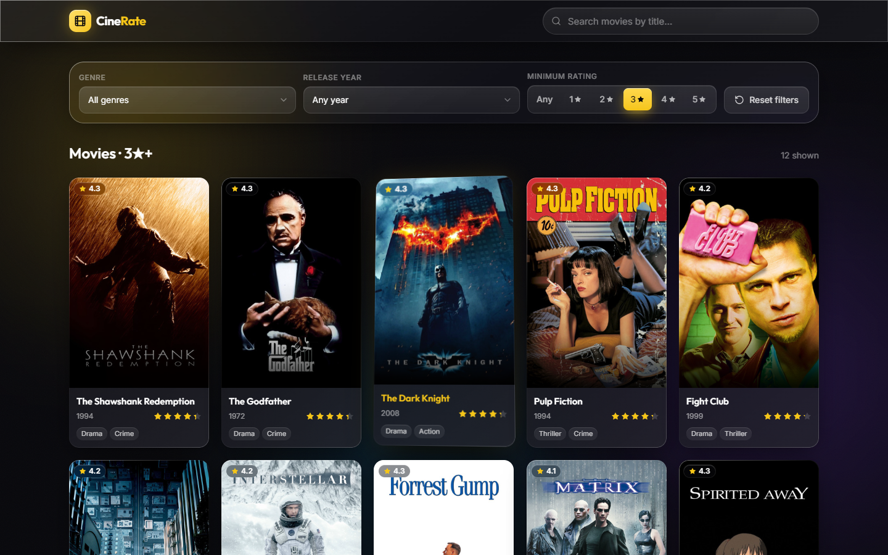
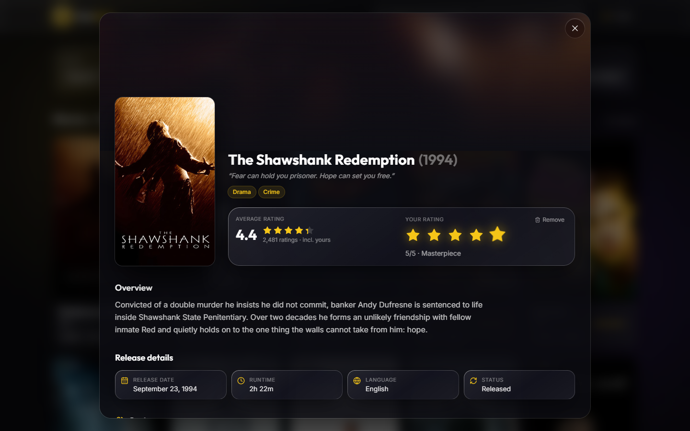
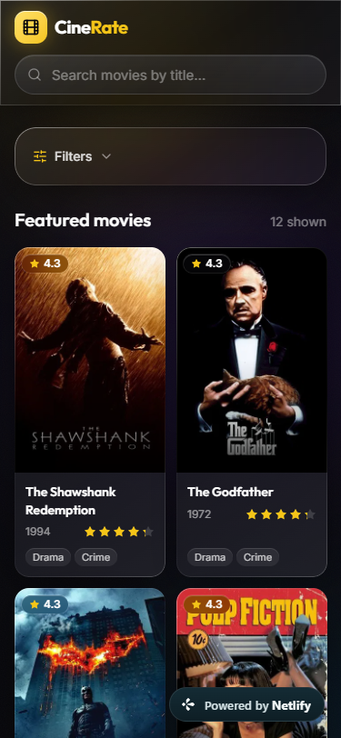

# CINEMOVIE: CineRate Movie Reviews

**Live demo: [cinerate-movie-review.netlify.app](https://cinerate-movie-review.netlify.app)**



A responsive movie discovery and review app built with **React**, **Vite**, and **Tailwind CSS**. You can browse popular titles, search and filter them, open full details with cast, and rate any movie from 1 to 5 stars. Your ratings are saved in your browser.

It runs entirely on a built-in catalogue of 29 films spanning 1942–2024 and 16 genres. No API key, backend or setup is needed.

## Features

- **Movie listings**: a poster grid showing title, release year, genre tags and the average star rating. Movies load 12 at a time with a **Load more** button. Skeleton cards show while data loads, and a generated placeholder replaces any poster that is missing or fails to load.
- **Search and filters**: title search runs as you type (debounced, with a clear button). You can filter by **genre**, **release year** and **minimum rating** (1–5★). The filters can be combined with each other and with the search. There is a **Reset filters** button and an empty-state screen when nothing matches.
- **Movie details**: an accessible modal with the backdrop, poster, tagline, genres, overview, release date, runtime, language, status, and **cast** (actor and character names, with initials avatars). You can close it with Esc, the close button, or a click on the backdrop. Focus stays inside the modal while it is open.
- **Star ratings**:
  - Hover to preview, click or tap to rate, use the arrow keys, and change or remove a rating at any time.
  - Each film's 10-point community score is converted to 5 stars. Your rating is folded into the average using the vote count: `(avg × votes + yours) / (votes + 1)`.
  - Ratings are stored in `localStorage`. They survive reloads, stay in sync across tabs, and update the details view and the movie cards immediately.
- **Resilience**: React Error Boundaries catch unexpected UI errors, and the details view shows an error state with a retry option.
- **Glass UI and motion**:
  - Frosted glass panels with specular edges sit over slowly drifting ambient colour fields.
  - Movie cards tilt in 3D towards the pointer, with a light glare that follows it.
  - Clicks send out a ripple, a new rating pops the star with a particle burst, and the minimum-rating selector has a spring-animated pill.
  - Cards fade in one after another, and the details modal opens and closes with spring animations.
- **Responsive**: 2 columns on mobile (with a collapsible filter panel), 3 on tablet, and 4–5 on desktop. There is no horizontal overflow at 375 px. The app respects `prefers-reduced-motion`.

## Screenshots

| Details and rating | Mobile (375 px) |
| --- | --- |
|  |  |

## Tech stack

| Concern | Choice |
| --- | --- |
| Framework | React 19 + Vite (JavaScript / JSX) |
| Styling | Tailwind CSS v4 (`@tailwindcss/vite`) |
| State | React Hooks + Context (`useState`, `useEffect`, `useMemo`, `useCallback`, `useContext`, custom hooks) |
| Icons | lucide-react |
| Data | Local JSON-style catalogue (`src/data/movies.js`) |

## Getting started

```bash
git clone https://github.com/pradeepkkumarA/CINEMOVIE.git
cd CINEMOVIE
npm install
npm run dev               # http://localhost:5173
```

Production build:

```bash
npm run build
npm run preview
```

### Single-file HTML build

```bash
npm run build:html        # creates release/movie-review.html
```

This produces one self-contained HTML file with all JavaScript and CSS inlined. You can open it in any browser by double-clicking it; no server is needed.

## Project structure

```
src/
├── components/   UI components (cards, filters, modal, star rating, error boundary…)
├── context/      RatingsContext (user ratings persisted to localStorage)
├── data/         Movie catalogue
├── hooks/        useDebounce, useMovieCatalog, useMovieDetails, useDecorateMovie
├── services/     movieService.js (search, filtering, paging, details)
├── utils/        Rating maths, formatting, image and ripple helpers
├── App.jsx
└── main.jsx
```

## Deploying to Netlify

The live site is hosted on Netlify at **https://cinerate-movie-review.netlify.app**.

`netlify.toml` already sets the build command (`npm run build`), the publish directory (`dist`) and an SPA redirect (`/* → /index.html 200`).

**Option A: from GitHub (recommended)**

1. Push this repository to GitHub.
2. In Netlify, choose **Add new site → Import an existing project → GitHub** and pick the repo. The build settings are read from `netlify.toml`.
3. Click **Deploy**.

**Option B: Netlify CLI**

```bash
npm install -g netlify-cli
netlify login
netlify init        # or: netlify link
netlify deploy --build --prod
```

## Attribution

Poster images are loaded from the TMDB image CDN. If an image can't load, a generated placeholder is shown instead.
